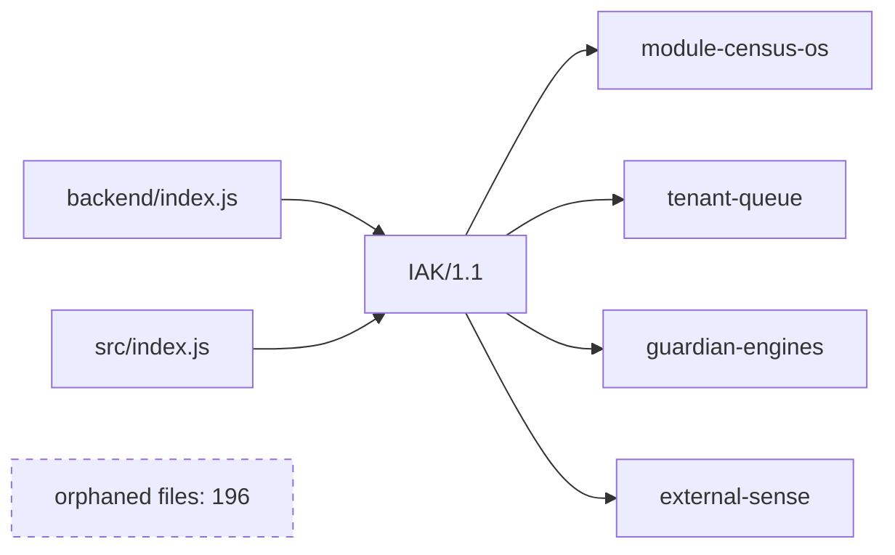

# System map

Static require graph of `backend/modules`. Nothing in this file was started to produce it.

The only orchestrator is Integrated Autonomy Kernel `IAK/1.1`. The names central-orchestrator, unicornMeshOrchestrator, unicornOrchestrator, meshOrchestrator, saas-orchestrator-v4, recovery-orchestrator, billion-scale-activation-orchestrator are shims.

| Status | Count |
|---|---|
| active | 490 |
| orphaned | 196 |
| dead | 0 |

Orphaned means the file is not reachable by a static `require` from `backend/index.js` or `src/index.js`. IAK can soft-require some of them later. This map does not call that scan, because the scan executes modules.

Sample of orphaned files:

- `backend/modules/AGISelf-EvolutionEngine.js`
- `backend/modules/AdaptiveModule01.js`
- `backend/modules/AdaptiveModule02.js`
- `backend/modules/AdaptiveModule03.js`
- `backend/modules/AdaptiveModule04.js`
- `backend/modules/AdaptiveModule05.js`
- `backend/modules/AdaptiveModule06.js`
- `backend/modules/AdaptiveModule07.js`
- `backend/modules/AdaptiveModule08.js`
- `backend/modules/AdaptiveModule09.js`
- `backend/modules/AdaptiveModule10.js`
- `backend/modules/AdaptiveModule11.js`
